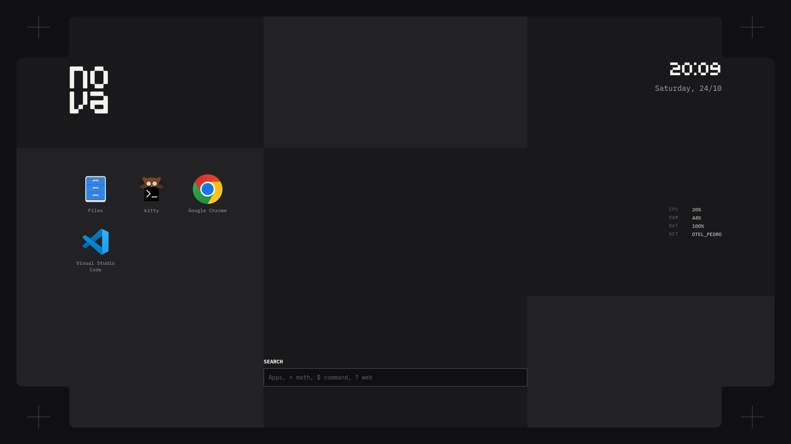
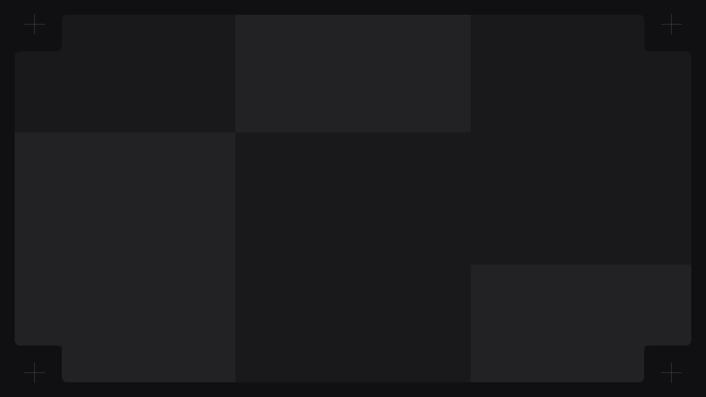

<div align="center">
    <h1>【 NOVA Shell 】</h1>
    <p>A minimalist desktop-first graphical shell for Hyprland built with Quickshell</p>
</div>

<div align="center">


</div>

<div align="center">
    <h2>• overview •</h2>
</div>

> [!NOTE]
> **Desktop-first canvas**: NOVA discards traditional top bars, floating docks, and pop-up sidebars. Everything—system telemetry, application launcher, search, and authentication—lives directly on the desktop surface in a unified single panel.

<details>
  <summary>What this is / isn't</summary>

  - **What it is**: A clean, modular, high-performance desktop shell for Hyprland written in QtQuick / QML with Quickshell.
  - **Single panel design**: No intrusive overlays or floating bars competing for window space.
  - **Solid backend**: Reuses the tested backend services from [end-4/dots-hyprland](https://github.com/end-4/dots-hyprland) for hardware controls, network, bluetooth, and audio.
  - **What it isn't**: A whole Linux distribution setup script (it assumes Hyprland and graphics drivers are already installed and configured).
</details>

<details>
  <summary>Notable features</summary>

  - **Desktop-integrated HUD**: Live clock, date, system metrics, hardware telemetry, and app launcher on the wallpaper canvas.
  - **Integrated desktop search**: Fuzzy app search and calculation directly on the desktop.
  - **Futuristic Lockscreen**: Authentic glitch transitions, text scrambler, and clean square-wave authentication flow.
  - **Curated fixed palette**: High-contrast, clean neon accenting (`#C2FF3D`) without complex dynamic wallpaper parsing dependencies.
  - **Dual-shell workflow**: Seamlessly switch between NOVA and other Quickshell setups with zero friction.
  - **Isolated headless test harness**: Test widgets and capture snapshots headlessly without disturbing your active session.
</details>

<details open>
  <summary>Installation & Quick Start</summary>

  ### Prerequisites

  Ensure the following packages are installed on your system:
  - **[Quickshell](https://quickshell.outfoxxed.me/)** (Qt6 Wayland widget system)
  - **[Hyprland](https://github.com/hyprwm/hyprland)** (Wayland compositor)
  - **Backend utilities**: `wireplumber` (`wpctl`), `brightnessctl`, `nmcli`, `bluetoothctl`, `playerctl`

  ### 1. Clone the repository

  ```bash
  git clone https://github.com/P3DROVFX/nova.git ~/.config/quickshell/nova
  cd ~/.config/quickshell/nova
  ```

  ### 2. Run automated setup

  The automated installer copies bundled fonts (`Architype Stedelijk W00` and `IBM Plex Mono`), refreshes font cache, and links helper scripts:

  ```bash
  ./setup install
  ```

  You can also check for missing dependencies at any time:
  ```bash
  ./setup check
  ```

  ### 3. Launch NOVA

  To test NOVA standalone:
  ```bash
  qs -c nova
  ```

  ### 4. Hyprland configuration

  Add the following to your `hyprland.conf`:

  ```ini
  # Autostart NOVA shell
  exec-once = qs -c nova

  # Keybinds
  bind = SUPER, Space, global, quickshell:searchToggleRelease
  bind = SUPER, L, exec, loginctl lock-session
  ```

  ### 5. Multi-shell switcher (optional)

  If you have an existing shell (like `ii` or `end4`), use the bundled switcher to swap between them seamlessly:

  ```bash
  nova-switch nova    # Switch to NOVA
  nova-switch ii      # Switch to your previous shell
  nova-switch toggle  # Toggle between them
  nova-switch status  # Show active shell
  ```
</details>

<details>
  <summary>Keybinds & Controls</summary>

  | Action | Key / Trigger | Description |
  | --- | --- | --- |
  | **Desktop Search** | `SUPER` + `Space` or click search bar | Focuses application launcher search |
  | **Lock Screen** | `SUPER` + `L` / `loginctl lock-session` | Activates full lockscreen surface |
  | **Clear Input** | `Escape` | Clears password field or search input |
  | **Submit / Login** | `Return` | Submits password / launches selected application |
  | **Shell Toggle** | `nova-switch toggle` | Switches active Quickshell environment |
</details>

<details>
  <summary>Architecture & File Structure</summary>

  ```
  ~/.config/quickshell/nova/
  ├── assets/                # Wallpapers, screenshots, and bundled fonts
  ├── modules/
  │   ├── common/            # Singletons (Theme, Config) and modular UI components
  │   ├── desktop/           # Desktop panel, header, icons, telemetry, and search
  │   ├── dev/               # Headless mock context and IPC devtools
  │   └── lock/              # Lockscreen interface, state machine, and transitions
  ├── scripts/
  │   ├── nova-switch        # Seamless shell switcher for Hyprland
  │   └── test-headless      # Isolated headless compositor test harness
  ├── services/              # Ported backend hardware and system services
  ├── setup                  # Quick installer and dependency checker
  └── shell.qml              # Shell entry point
  ```
</details>

<div align="center">
    <h2>• screenshots •</h2>
</div>

<div align="center">

| Desktop Canvas | Lockscreen & Authentication |
|:---:|:---:|
|  |  |

</div>

<div align="center">
    <h2>• credits •</h2>
</div>

- **[end-4](https://github.com/end-4/dots-hyprland)**: Core backend services architecture and hardware integrations.
- **[Outfoxxed](https://github.com/outfoxxed)**: [Quickshell](https://quickshell.outfoxxed.me/) widget framework.
- **[Hyprland](https://github.com/hyprwm/hyprland)**: Dynamic tiling Wayland compositor.
